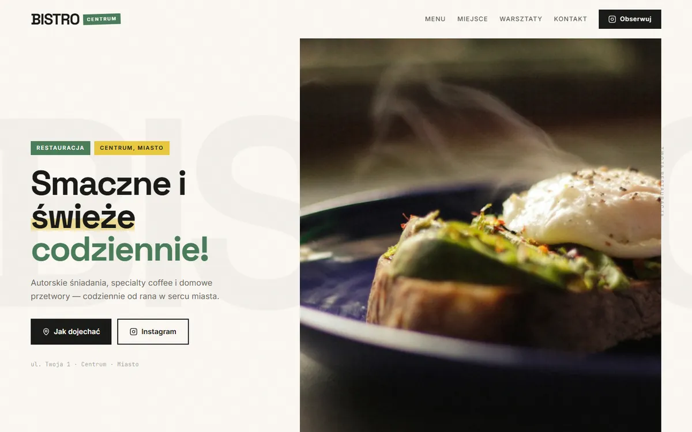
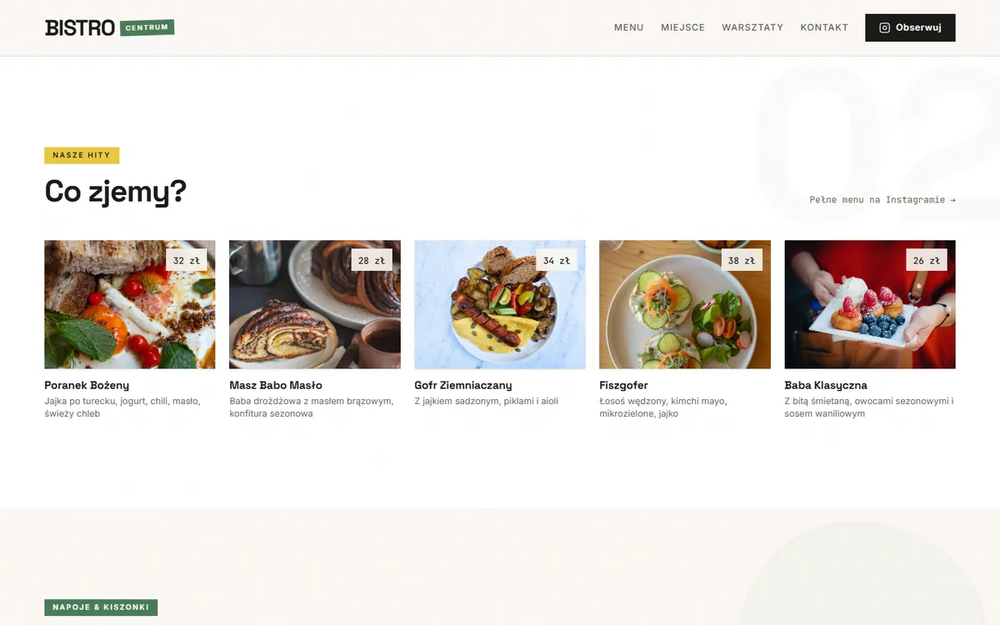
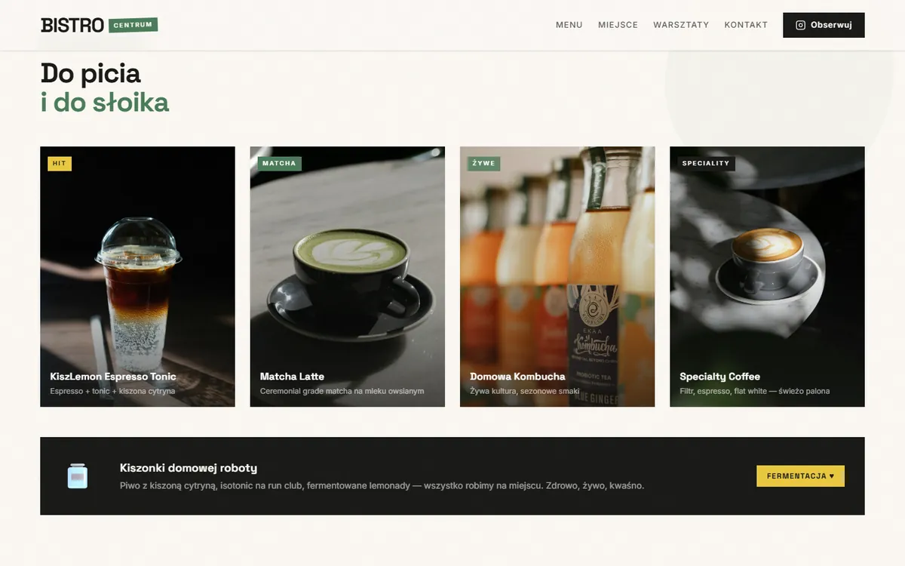
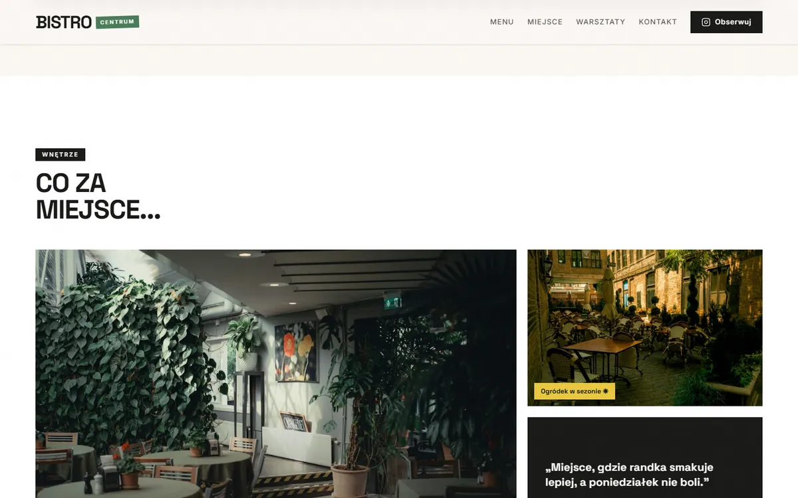
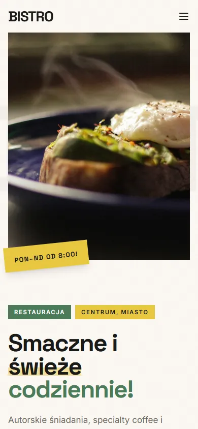
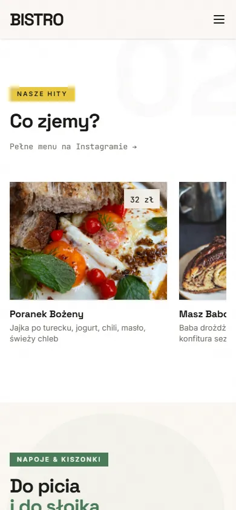
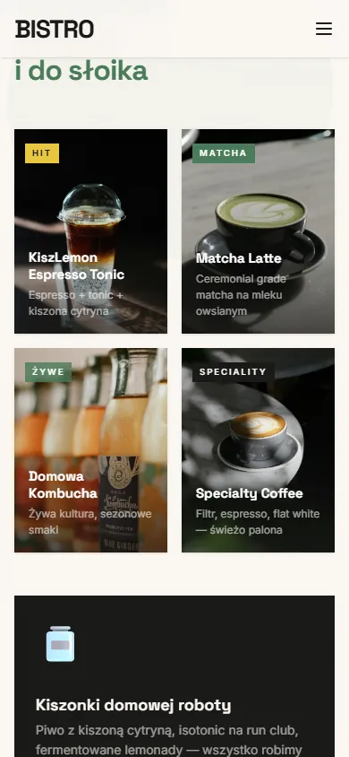

# Bistro

**Jednostronicowa strona bistro z kartą dań i napojów, prezentacją miejsca oraz warsztatów kulinarnych.**

**Strona: [bistro-restaurant-umber.vercel.app](https://bistro-restaurant-umber.vercel.app)**

Bistro jest fikcyjnym lokalem — strona prezentuje przykładową ofertę i dane kontaktowe.



## Po co to jest

Gość może sprawdzić, co zje i wypije, poznać charakter miejsca oraz znaleźć informacje
o warsztatach i dojeździe. Sekcje mają wspólny motyw graficzny inspirowany gofrem.

- **Karta dań:** zdjęcia, nazwy, składniki i ceny, uzupełnione etykietami.
- **Napoje:** osobna sekcja menu z opisami i cenami.
- **O lokalu i miejscu:** zdjęcia oraz opis charakteru bistro.
- **Warsztaty kulinarne:** prezentacja oferty zajęć.
- **Lokalizacja i kontakt:** mapa, godziny otwarcia i adres e-mail w stopce.

| **Karta dań** | **Karta napojów** |
|---|---|
|  |  |
| **Miejsce i jego charakter** | |
|  | |

### Na telefonie

| **Start** | **Menu** | **Napoje** |
|---|---|---|
|  |  |  |

## Co jest w środku

**Front:** React, TypeScript, Vite i Tailwind CSS. Sekcje strony składa komponent
`HomePage`, a wspólny układ odpowiada za nawigację, stopkę i ekran wczytywania.

**Animacje wejścia:** Motion oraz własny hook `useInView` oparty na IntersectionObserver.
Po pierwszym pojawieniu się sekcji hook zapamiętuje jej widoczność i przestaje ją obserwować.

**Motyw gofra:** komponenty SVG w `waffle-pattern.tsx` służą jako dekoracyjne wzory.
Karty dań i etykiety mają osobne komponenty, dzięki czemu sekcje współdzielą ich wygląd.

**Treść:** dania i napoje są zapisane w tablicach w komponentach. Strona prezentuje
ofertę; nie realizuje zamówień ani rezerwacji online.

**Pochodzenie i zależności:** szkielet pochodzi z Figma Make, a komponenty bazowe
z shadcn/ui, opartego na Radix UI, na licencji MIT. Zdjęcia pochodzą z Unsplash.
Informacje o tych materiałach zawiera [ATTRIBUTIONS.md](ATTRIBUTIONS.md).

## Uruchomienie

```bash
npm install
npm run dev        # serwer deweloperski Vite
npm run build      # build do dist/
```

## Struktura

```text
src/
  app/
    components/     sekcje strony, karty, wzory SVG i hook widoczności
      ui/           komponenty bazowe
    routes.tsx      routing strony
    App.tsx         główny komponent aplikacji
  styles/           fonty, motyw i konfiguracja stylów Tailwind
  main.tsx          punkt wejścia
docs/zrzuty/        zrzuty na komputerze i telefonie
```

Licencja: MIT

---

Projekt i wykonanie: **Mikołaj Sitek** · [sitekmikolaj.pl](https://sitekmikolaj.pl) · [sitekmikolaj01@gmail.com](mailto:sitekmikolaj01@gmail.com)
